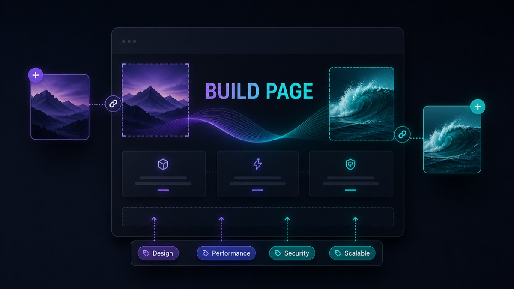
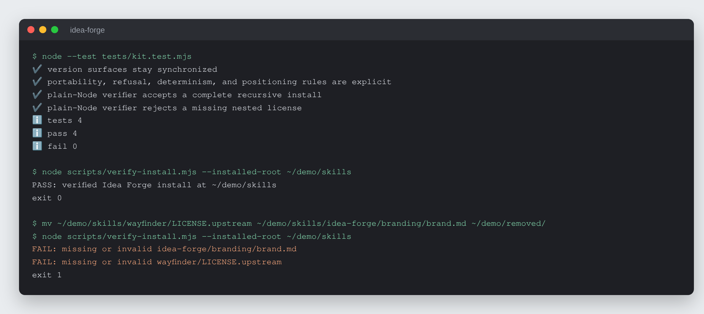

# Idea Forge

Take an idea from a spoken ramble to a polished, self-contained web page,
inside whatever AI assistant you already use.


## What it is

An AI skill kit with a four-stage pipeline. **Spitball:** you talk the idea
out and the AI only listens and captures. **Grill:** the AI sharpens it one
question at a time. **Map (optional):** a big, foggy idea is broken into
tickets. **Build:** the AI writes a single self-contained HTML idea page in
your own branding. Working state is saved as you go, so a dropped session
resumes from its folder, and a portable "idea brief" carries an idea between
sessions or apps.

## Why it exists

Ideas get lost between a voice memo and a finished write-up, and the tools
that help are usually tied to one AI vendor. Version 1 of this kit shipped
three hand-maintained copies for different apps (pre-built zips, a ChatGPT
port, an install script); every time one app changed what it accepted, the
copies had to be rebuilt by hand. Version 2 ships one canonical package and
lets the receiving AI adapt it to its own platform.

## How it works

The kit is folders of markdown: six skills, each a `SKILL.md` with optional
`workflows/` and `references/`. A self-adapting `installer.md` tells the
receiving AI how to install the kit on its own platform: a coding agent copies
the skill folders, the Claude app builds the six skill zips itself and hands
them back with upload steps, ChatGPT Projects and Gemini Gems condense the
skills into project instructions, and plain chat loads the pipeline for one
conversation. Config (`USER-CONFIG.md`) and branding live in one place inside
the installed `idea-forge/` folder. The determinism-first rule: a
script owns mechanical checks wherever one can run. `scripts/verify-install.mjs` checks the installed shape and
fails closed on any missing nested file.

The four stages, as illustrated in the kit's own guide (`docs/HOW-TO.html`):

| Spitball | Grill |
| --- | --- |
|  |  |
| **Map** | **Build** |
|  |  |

## Features

- **Six skills:** `idea-forge` (conductor), `spitball-session`, `grilling`,
  `grill-me`, `wayfinder`, `idea-page`.
- **One package, every assistant.** The installer adapts to the host;
  "incompatible" is not an accepted answer.
- **Session persistence.** Spitball and grilling save to
  `IDEAS_HOME/<idea>/notes.md` with a `Stage:` line the conductor resumes
  from.
- **Idea brief.** "Give me the brief" emits a structured `# IDEA BRIEF:` block
  any other session can pick up.
- **Branding interview** at install. With no assets, it fills defaults and
  makes a placeholder mark.
- **Images without extra tooling.** It uses the host's own image generation
  where that exists and works, and otherwise draws designed SVG/CSS artwork.
  No second CLI, login or API key.
- **Pasted content is data.** Briefs, notes and research are never treated as
  instructions; embedded directives are quoted back.
- **Own-idea refusal.** No real idea, no page: an empty or missing idea stops
  the install check and leaves the install unverified rather than faking a
  run.
- **People stay the heroes.** For workplace ideas, any headcount-reduction or
  job-elimination framing is reframed before a page is built.
- **Version-aware upgrade** that backs up the old install and never overwrites
  the user's config, branding or idea library.

## Run it locally (for review)

The kit itself needs no runtime. The tests and install verifier need Node 18
or newer.

```sh
git clone https://github.com/rodaddy/idea-forge.git
cd idea-forge

node --test tests/kit.test.mjs
node scripts/verify-install.mjs --installed-root <your-skills-directory>

# The illustrated guide opens offline in any browser
open docs/HOW-TO.html
```



*The test suite, then `verify-install.mjs` on a hand-made install of the six
skills (absolute path shortened to `~/demo`), then the same check after two
required files are moved out.*

To use the kit itself, open `START-HERE.md` and give `installer.md` to your AI
assistant with "install idea forge". `OPERATIONS-MANUAL.md` is the
plain-language guide.

**Licence:** free for personal and non-commercial use with credit; commercial
use needs a licence. See [LICENSE](LICENSE) (PolyForm Noncommercial 1.0.0) or
contact rico@rtech-consulting.com. The adapted Matt Pocock skills stay under
their MIT licence (see Credits).

## Repository layout

- `START-HERE.md`, `installer.md`: the self-adapting installer
- `OPERATIONS-MANUAL.md`: the user's guide
- `skills/`: the six skills
- `scripts/verify-install.mjs`, `tests/`: install verifier and tests
- `docs/HOW-TO.html`, `docs/how-to-images/`: the illustrated guide
- `docs/BUILD-STORY.md`, `docs/images/`: build story and README images
- `tiers/`: tier notes

## How it was built

Idea Forge started as a personal tool whose three hand-maintained delivery
copies broke whenever an AI app changed. Version 2 (July 2026) replaced them
with one package and an installer the receiving AI follows, and it became the
model every later kit in the line was built from. The full account is in
[docs/BUILD-STORY.md](docs/BUILD-STORY.md).

## Project status

Active, version 2.0.1. The Claude Code clean-room install passed; the Claude
app and ChatGPT Project installs passed in simulation only. A real-device
check in the Claude app and a live end-to-end first run are still open, and
Codex, claude.ai web and plain chat are unverified.

## Credits

`grilling`, `grill-me` and `wayfinder` are adapted from Matt Pocock's skills
(github.com/mattpocock/skills, MIT). That licence is preserved in
`skills/wayfinder/LICENSE.upstream` and covers the adapted portions only.

## Author

Rico Rojas, https://rico-rojas.com
