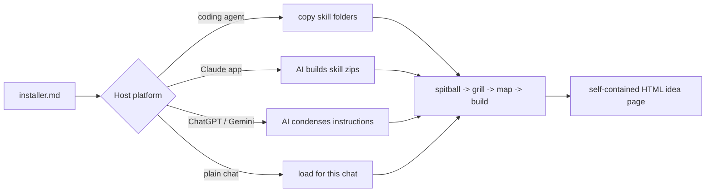

# Idea Forge

An AI skill kit that takes an idea from a spoken ramble to a polished,
self-contained web page.

> Portfolio piece. Source shown for review only; not licensed for use. See LICENSE.

## What it does

Idea Forge is a four-stage pipeline that runs inside whatever AI assistant the
user already has. **Spitball:** the user talks the idea out and the AI just
listens and captures. **Grill:** the AI sharpens it one question at a time.
**Map (optional):** a big, foggy idea is broken into tickets. **Build:** the
AI writes a single self-contained HTML idea page in the user's own branding.
Session state is saved as the user goes, so a dropped session resumes from its
folder. A portable "idea brief" carries an idea between sessions or apps.

## The problem

Ideas get lost between a voice memo and a finished write-up, and the tools
that help are usually tied to one AI vendor. Version 1 of this kit shipped
three hand-maintained copies for different apps (pre-built zips, a ChatGPT
port, an install script). When one app changed what it accepted, the user had
to repackage by hand. Version 2 ships one canonical package and lets the
receiving AI adapt it.

## How it works

The kit is folders of markdown: six skills, each a `SKILL.md` with optional
`workflows/` and `references/`. A self-adapting `installer.md` tells the
receiving AI how to install itself on its own platform. A coding agent copies
the skill folders into its skills directory. The Claude app builds the six
skill zips itself and hands them back with upload steps. ChatGPT Projects and
Gemini Gems condense the skills into project instructions. Plain chat loads
the pipeline for one conversation. Config (`USER-CONFIG.md`) and branding
(`branding/brand.md`, `branding/image-setup.md`) live in one canonical place
inside the installed `idea-forge/` folder. The determinism-first rule: a
script owns mechanical checks wherever one can run. Here
`scripts/verify-install.mjs` checks the installed shape and fails closed on
any missing nested file.



## Features

- **Six skills:** `idea-forge` (conductor), `spitball-session`, `grilling`,
  `grill-me`, `wayfinder`, `idea-page`.
- **One package, every harness.** "Incompatible" is not an accepted answer;
  the installer adapts and continues.
- **Session persistence.** Spitball and grilling auto-save to
  `IDEAS_HOME/<idea>/notes.md` with a `Stage:` line the conductor resumes
  from.
- **Idea brief.** "Give me the brief" emits a structured `# IDEA BRIEF:` block
  that any other session can pick up.
- **Branding interview** at install. With no user assets, it fills defaults and
  generates a placeholder mark.
- **Image handling without extra tooling.** It uses the host's native image
  generation where it exists and works. Otherwise it draws designed SVG/CSS
  artwork. No second CLI, login or API key.
- **Pasted content is data.** Briefs, notes and research are never treated as
  instructions. Embedded directives are quoted back.
- **Own-data refusal.** A missing or empty real idea stops the install check
  and leaves the install unverified rather than faking a run.
- **Positioning guard.** For workplace ideas, extend and enhance, never
  replace: any headcount-reduction or job-elimination framing is reframed
  before a page is built.
- **Version-aware upgrade** that backs up the old install and never overwrites
  the user's config, branding or idea library.
- **Illustrated guide** in `docs/HOW-TO.html`.

## Stack

Markdown skill files (harness-agnostic: Claude Code, Codex, Claude app,
ChatGPT, Gemini, plain chat), self-contained HTML output, and an optional
plain-Node install verifier and test suite (`node:test`, no dependencies). The
buyer path needs no runtime at all.

## Status

Active, version 2.0.1. The Claude Code clean-room install passed. The Claude
app and ChatGPT Project installs passed in simulation only. A real-device
check in the Claude app and a live end-to-end first run are still
outstanding, and Codex, claude.ai web and plain chat are unverified.

## Running it locally (for reviewers)

```bash
node --test tests/kit.test.mjs
node scripts/verify-install.mjs --installed-root <path-to-installed-skills>
```

Open `docs/HOW-TO.html` in a browser for the illustrated walkthrough. The
kit's own install and operating docs are `START-HERE.md`, `installer.md` and
`OPERATIONS-MANUAL.md`.

## Screenshots

The illustrated guide uses the images in `docs/how-to-images/`:


## Credits

`grilling`, `grill-me` and `wayfinder` are adapted from Matt Pocock's skills
(github.com/mattpocock/skills, MIT). That licence is preserved in
`skills/wayfinder/LICENSE.upstream` and covers the adapted portions only.

## Author

Rico Rojas, rico@rtech-consulting.com, https://rico-rojas.com
